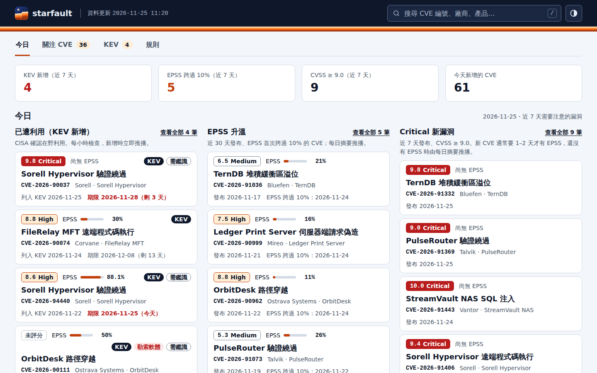
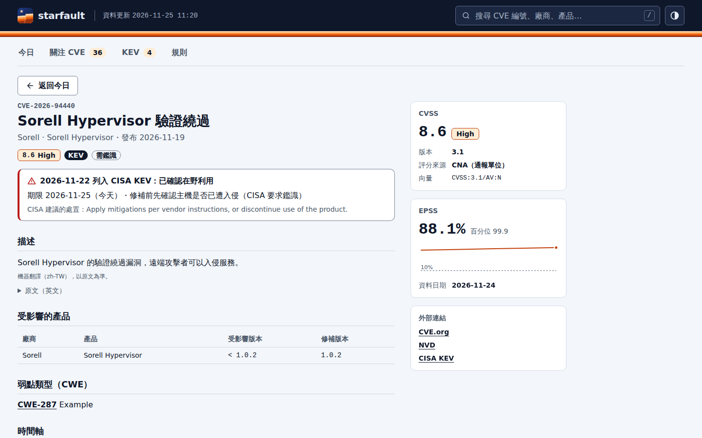

<p align="center">
  
</p>

<h1 align="center">starfault</h1>

<p align="center"><a href="README.md">English</a> | 繁體中文</p>

<p align="center">
  <a href="LICENSE"></a>
</p>

starfault 是每日 CVE 儀表板：追蹤已遭利用（CISA KEV）、EPSS 升溫與 Critical 漏洞，並由 Telegram bot「地質學家」推播。它和 starstrata、starcore 屬於同一個家族，共用版面、元件與 bot。

- **KEV 新增即時推播**：每小時檢查 CISA KEV，新增的 CVE 一則一則推播，附期限、是否需鑑識。
- **每日摘要**：EPSS 首次跨過門檻的新 CVE、CVSS ≥ 9 但還沒有 EPSS 的新 CVE。
- **技術棧特別關注**：私人清單裡的產品出現新漏洞時，列在每日摘要最上面。清單只存在 GitHub secret，不出現在網站、log 或 repo。
- **網站**：今日頁、關注 CVE、KEV 目錄、CVE 詳細頁、推播規則與門檻校準。介面可選繁體中文或英文，CVE 標題與描述可翻成 `translation.target` 設定的語言。
- 全部在 GitHub Actions 上執行，狀態存成 repo 裡的 JSON，不需要伺服器或資料庫。





## 開始前須知

- **費用**：公開 repo 使用 GitHub 提供的標準 runner 免費（[GitHub Actions 計費](https://docs.github.com/en/billing/concepts/product-billing/github-actions)）。hourly workflow 每天執行 24 次。
- **收錄範圍**：網站只收錄符合推播規則的 CVE（KEV、EPSS 升溫、Critical）。其他 CVE 請到 [CVE.org](https://www.cve.org) 或 [NVD](https://nvd.nist.gov) 查詢。
- **推播時間**：GitHub Actions 的排程在負載高時會延後，負載夠高時會丟棄部分執行（[GitHub 文件](https://docs.github.com/en/actions/reference/workflows-and-actions/events-that-trigger-workflows#schedule)）。KEV 推播會晚幾十分鐘到數小時。
- **門檻是暫定值**：`thresholds` 的門檻要用上線後一週的實際資料校準，規則頁的「門檻校準」表列出各門檻每天會推播幾則。
- **Telegram 群組必須是私人群組**：每日摘要的「你的技術棧」段落會透露你的技術棧。不要設公開帳號，邀請連結不要外流。
- **Gemini 免費方案**：Google 會用免費服務收到的內容改進產品，也可能經人工審閱（[Gemini API 條款](https://aistudio.google.com/docs/terms)）。starfault 只送出網站收錄的公開 CVE 標題與描述，不送出技術棧清單。

## 部署自己的版本

1. fork 這個 repo，保持公開。Actions 頁面要求啟用 workflow 時，選擇啟用。
2. 編輯 `config.toml`：
   - `site.url` 改成 `https://<你的帳號>.github.io/<repo>/`。設為 `""` 時，Telegram 不附網站按鈕，分享預覽標籤也不帶網址與圖片。
   - `site.locale` 設為 `zh-TW` 或 `en`，決定網站與 Telegram 訊息的語言。
   - `translation.target` 設成 CVE 標題與描述要翻成的語言（例如 `ja`）；設為 `""` 則不翻譯。
3. `state/` 底下有檔案時全部刪除：那是原作者的狀態。第一次執行會重新建立這個目錄。
4. 在 Settings → Secrets and variables → Actions 建立 secrets：

   | 名稱 | 必要 | 用途 |
   |---|---|---|
   | `TELEGRAM_BOT_TOKEN` | 否 | Telegram bot token；未設定時不發送訊息 |
   | `TELEGRAM_CHAT_ID` | 否 | 接收訊息的群組；見 [Telegram](#telegram) |
   | `STARFAULT_WATCHLIST` | 否 | 技術棧清單（TOML）；見 [技術棧特別關注](#技術棧特別關注) |
   | `GEMINI_API_KEY` | 否 | 翻譯（預設供應商），在 [Google AI Studio](https://aistudio.google.com) 免費建立。未設定時顯示原文 |
   | `ANTHROPIC_API_KEY` | 否 | `translation.provider` 設為 `anthropic` 時改用 Claude |

   要發到群組的某個主題時，另外在同一頁的 Variables 分頁建立 repository variable `TELEGRAM_THREAD_ID`。它是 variable 而不是 secret：GitHub 會把 secret 的值從 log 遮掉（[GitHub 文件](https://docs.github.com/en/actions/concepts/security/secrets)），`7` 這種短數字會讓 log 裡相同的數字都被遮掉。

5. 在 Settings → Pages → Build and deployment，把 Source 設為 **GitHub Actions**。
6. 第一次執行：
   1. Actions → `Hourly` → Run workflow。第一次只建立 KEV 快照，不推播。
   2. Actions → `Daily` → Run workflow，`backfill_days` 填 `30`：讀取近 30 天的 CVE，今日頁的圖表與門檻校準表的 CVSS 列就有資料。
      - 補讀的 CVE 無法得知何時首次跨過 EPSS 門檻：已達門檻的會加進網站但不推播，門檻校準表的 EPSS 列在之後 7 天逐步有資料。

   也可以用 `gh`：

   ```sh
   gh workflow run hourly.yml -R <owner>/<repo>
   gh workflow run daily.yml -R <owner>/<repo> -f backfill_days=30
   ```

之後 `Hourly` 每小時第 23 分執行，`Daily` 每天 UTC 22:17（`Asia/Taipei` 06:17）執行。每次執行會：

- 把狀態 commit 到 `state/`；
- 發送 Telegram 推播；
- 部署網站到 GitHub Pages。

KEV 每筆 CVE 的完整紀錄每次補抓 100 筆，大約 18 小時補齊；補齊前，詳細頁改用 KEV 目錄的描述。

## Telegram

1. 用 [@BotFather](https://t.me/BotFather) 建立 bot，複製 token。bot 頭像可以用 `assets/bot-avatar.png`（「地質學家」，三個專案共用）。
2. 建立私人群組，把 bot 加進去，在群組裡傳 `/start@<bot 帳號>`。bot 預設開啟 privacy mode，在群組裡只收得到指名給它的指令（[privacy mode](https://core.telegram.org/bots/features#privacy-mode)）。
3. 查出 chat ID：在回應中找 `chat.type` 為 `group` 或 `supergroup` 的訊息，使用它的 `chat.id`。

   ```sh
   curl -s "https://api.telegram.org/bot<token>/getUpdates"
   ```

4. 把 `TELEGRAM_BOT_TOKEN` 與 `TELEGRAM_CHAT_ID` 存成 secrets。

要把訊息發到開啟 Topics 的群組裡的某個主題：

1. 在群組設定開啟 Topics。有主題的群組是超級群組，一般群組升級後會換成新的 chat ID（[`migrate_to_chat_id`](https://core.telegram.org/bots/api#message)），要更新 `TELEGRAM_CHAT_ID`。
2. 在目標主題裡傳 `/start@<bot 帳號>`。
3. 在上面 `getUpdates` 的回應中，這則訊息的 `message.message_thread_id` 就是主題 ID，存成 repository variable `TELEGRAM_THREAD_ID`。

沒有設定 `TELEGRAM_THREAD_ID` 時，訊息發到 General（[Telegram 論壇說明](https://core.telegram.org/api/forum)）。值不是正整數時不發送任何訊息，workflow 標為失敗。

| 訊息 | 時機 | 通知音 |
|---|---|---|
| KEV 新增 | 每小時檢查，一則一個 CVE，附「詳細頁」「CISA KEV」按鈕 | 有 |
| 每日摘要 | 每天一次；沒有內容時不發 | 有「你的技術棧」段落時有，否則靜音 |
| 失敗通知 | workflow 失敗或逾時，附執行連結 | 有 |

## 技術棧特別關注

把你在意的產品寫成 TOML，存成 secret `STARFAULT_WATCHLIST`。格式見 [`watchlist.example.toml`](watchlist.example.toml)：

```toml
[[product]]
name = "Example Proxy"                 # 推播顯示的名稱
match = ["example proxy", "exproxy"]   # 產品名稱的各種寫法，至少一個
vendors = ["example labs"]             # 選填：限定廠商，排除同名產品
note = "前端代理"                       # 選填：顯示在推播
```

- 比對 CVE 的受影響產品、CPE 與 KEV 的產品欄位。大小寫與標點不影響比對，但要以完整詞出現：`quill` 不會命中 `quillstore`。
- 只比對產品，不看版本；推播附上 CVE 的受影響版本與修補版本，由你判斷。
- 同一個產品的不同寫法都要列在 `match`。廠商常用不同名稱，例如產品改名、被收購，或發行版重新包裝，`vendors` 要一併列出。
- 函式庫要另外列，例如應用程式內含的框架或 logging 套件；starfault 不掃描相依套件。
- 命中且 CVSS ≥ `watchlist.cvss`（預設 7.0）或還沒有分數的新 CVE，列在每日摘要最上面。列入 KEV 時，即時推播多一行「命中你的技術棧」。
- 清單不會出現在網站、狀態檔、Actions log 或 commit：log 不印產品名稱、命中的 CVE 或命中數；只因技術棧命中的 CVE 不收錄進網站，推播連到 CVE.org 與 NVD。
- 每日摘要只有「你的技術棧」段落時，Telegram 發送失敗後不再補發，workflow 照樣成功。失敗或補發都會公開透露有命中。

## 設定

所有設定都在 `config.toml`，每個鍵都有註解。未知的鍵或超出範圍的值會讓執行停止，結束碼 `2`。

| 區段 | 控制 |
|---|---|
| `[thresholds]` | EPSS 與 CVSS 門檻、EPSS 規則看發布幾天內的 CVE、門檻暫定期限 |
| `[translation]` | 翻譯的目標語言、模型供應商、模型、每批則數、每次上限與請求間隔 |
| `[watchlist]` | 技術棧命中時列入摘要的 CVSS 門檻 |
| `[site]` | 網站與訊息的語言、時區、網站網址 |

執行時間寫在 `.github/workflows/hourly.yml` 與 `daily.yml` 的 `cron`。

## 結束碼

workflow 執行的每個 `starfault` 指令都以下列結束碼結束。要在本機執行指令，見 [docs/DEVELOPMENT.md](docs/DEVELOPMENT.md)。

| 結束碼 | 意義 |
|---|---|
| `0` | 成功 |
| `1` | 資料來源讀取失敗或 Telegram 發送失敗；已取得的資料照常保存 |
| `2` | 設定錯誤、技術棧清單格式錯誤、`TELEGRAM_THREAD_ID` 不合法或 `--backfill-days` 不在 1 到 90，沒有執行任何工作 |

## 疑難排解與已知限制

- **KEV 推播晚到**：GitHub Actions 排程延後（[GitHub 文件](https://docs.github.com/en/actions/reference/workflows-and-actions/events-that-trigger-workflows#schedule)）。需要更即時時，用外部 cron 呼叫 `workflow_dispatch` 觸發 `Hourly`。
- **今日頁的來源停更提醒**：CVE 或 KEV 超過 3 小時沒有成功更新，或 EPSS 資料日期比今天早超過 2 天。workflow 失敗時，有設定 Telegram 的群組會收到失敗通知。
- **CVE 標題一直是英文**：starstrata 實際使用時，Gemini 免費方案在尖峰時常回應 `503`。沒有譯文時顯示原文，每天執行時再補翻；每次最多翻 `translation.max_per_run` 則。
- **詳細頁說「找不到」**：網站只收錄符合推播規則的 CVE；關注 CVE 保留到最後一個事件後 90 天。
- **技術棧漏報**：產品名稱的寫法不一致時比對不到。上線後用近期 CVE 檢查清單，把漏掉的寫法加進 `match`。
- **重複推播**：Telegram 確認收到後才記為已推播，發送失敗或中斷時整則重發。Telegram 收下訊息但回應失敗，或長摘要在第一段之後失敗時，已送出的部分會再發一次。

## 資料授權與致謝

- CVE 紀錄來自 [CVE Program](https://www.cve.org)（[使用條款](https://www.cve.org/Legal/TermsOfUse)），透過 [CVEProject/cvelistV5](https://github.com/CVEProject/cvelistV5) 取得，包含 CNA 與 CISA ADP（Vulnrichment）的內容。
- KEV 來自 CISA 的 [Known Exploited Vulnerabilities Catalog](https://www.cisa.gov/known-exploited-vulnerabilities-catalog)。KEV 的期限是美國聯邦機關的修補期限，這裡只當作急迫程度的參考。
- EPSS 分數來自 [FIRST](https://www.first.org/epss/)（Exploit Prediction Scoring System），依 FIRST 的要求標示來源。

## 開發

設計、資料格式、規則與測試見 [docs/DEVELOPMENT.md](docs/DEVELOPMENT.md)。

## 授權

[MIT](LICENSE)
