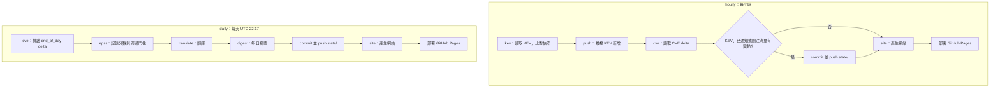

# 開發說明

本文件說明開發環境、資料格式、規則與執行流程。使用方式見 [README](../README.zh-TW.md)。

## 開發環境

需要 Python 3.14 以上與 [uv](https://docs.astral.sh/uv/)。相依套件依 `uv.lock` 安裝：

```sh
uv sync --locked
```

提交前四項檢查都要通過，與 CI 相同：

```sh
uv run ruff check .
uv run ruff format --check .
uv run mypy
uv run pytest
```

改了 `web/`、`site.py` 或網站資料的格式時，另外跑瀏覽器測試。第一次執行前先下載 Chromium：

```sh
uv run playwright install chromium
uv run pytest -m e2e
```

預覽網站：先依序執行 `kev`、`cve`、`epss` 建立 `state/`，再產生網站並起本機 server，開啟 `http://localhost:8000`。

```sh
uv run starfault kev
uv run starfault cve --backfill-days 3
uv run starfault epss
uv run starfault site
python3 -m http.server -d _site 8000
```

`tests/fixtures/` 的真實資料節錄可以用 `uv run python scripts/refresh_fixtures.py` 重新下載。更新後跑一次 pytest，依實際值調整斷言。

## 相依套件

- 直接相依寫在 `pyproject.toml`，開發用的工具在 `[dependency-groups] dev`。
- `uv.lock` 由 `uv lock` 產生，不手動編輯。改了 `pyproject.toml` 後執行 `uv lock`，兩個檔案一起 commit。
- CI 與 workflow 都用 `uv sync --locked`：`uv.lock` 與 `pyproject.toml` 不一致時直接失敗。
- Dependabot 每週檢查 uv 套件與 GitHub Actions 的更新（`.github/dependabot.yml`）。

## repo 結構

```
config.toml               門檻、翻譯、技術棧門檻、站台設定
watchlist.example.toml    技術棧清單的格式範例（虛構內容）
src/starfault/            抓取、解析、狀態、網站資料產生、通知
state/                    狀態檔，由 workflow commit
web/                      前端：index.html、style.css、i18n.js、app.js
assets/                   icon、社群分享圖、bot 頭像
scripts/                  開發用腳本
tests/                    pytest；fixtures/ 是真實資料的節錄；e2e/ 是瀏覽器測試
```

## 模組

| 模組 | 責任 |
|---|---|
| `config` | 讀取並驗證 `config.toml` |
| `http` | 抓取資料來源的共用 HTTP client：逾時、重試 |
| `records` | 解析 CVE JSON 5 紀錄：CVSS、標題、受影響產品、CWE、參考連結 |
| `cvelist` | 讀取 cvelistV5 的 delta release 與單筆紀錄 |
| `kev` | 讀取並解析 KEV 目錄 |
| `epss` | 讀取並解析 EPSS 每日 CSV |
| `state` | `state/` 底下各檔案的格式與讀寫 |
| `jsonio` | JSON 檔的固定格式與原子寫入 |
| `track` | 把新資料套用到狀態檔：每日新 CVE、關注清單、KEV 快照、EPSS |
| `view` | 網站收錄的 CVE 與收錄原因，網站與推播共用 |
| `site` | 從狀態檔產生網站 |
| `site_page` | 填入 `index.html` 的語言、分享標籤與 GitHub 連結 |
| `watchlist` | 技術棧清單的讀取與產品比對 |
| `notify` | KEV 即時推播與每日摘要 |
| `messages` | Telegram 訊息的文字（zh-TW、en） |
| `telegram` | 發送 Telegram 訊息 |
| `translate` | 翻譯網站收錄的 CVE 標題與描述 |
| `gemini` | 呼叫 Gemini API 取得 JSON 回應 |
| `cli` | 命令列入口 |

`telegram`、`translate`、`gemini` 的行為與 starstrata 相同。

## 執行流程



- 兩個 workflow 共用 `concurrency` 群組 `state`，同時只有一個在改狀態檔。
- hourly 只在 KEV 快照、已通知清單或關注清單有變動時 commit。每日新 CVE 紀錄跟著一起保存；沒有 commit 時，下一次執行會從 delta 重新算出今天的紀錄。
- daily 每次都 commit。
- 推播在 commit 之前，已通知清單跟狀態一起 commit。

## 資料來源與解析

| 來源 | 讀取 | 取出的欄位 |
|---|---|---|
| CVE List | cvelistV5 的 hourly delta 與 end_of_day delta；單筆紀錄讀 `raw.githubusercontent.com` | `cveId`、`state`、`datePublished`、`dateUpdated`；CNA 的 `title`、`descriptions`（en）、`metrics`、`problemTypes`、`affected`、`references`；CISA ADP 的 `metrics`、`problemTypes`、`affected` |
| KEV | 整份 JSON | `catalogVersion`、`dateReleased`；每筆的 `cveID`、`vendorProject`、`product`、`vulnerabilityName`、`shortDescription`、`dateAdded`、`dueDate`、`knownRansomwareCampaignUse`、`forensicTriage`、`requiredAction`、`notes`、`cwes` |
| EPSS | `epss_scores-current.csv.gz` | `cve`、`epss`、`percentile`；檔頭的 `model_version` 與 `score_date` |

- 每個請求逾時 60 秒，最多嘗試 3 次。連線錯誤與 5xx 間隔 2、4 秒重試；404 與其他狀態碼不重試。GitHub 限流（403、429）時這次讀取失敗，下一次排程再讀。
- delta 不是 zip 時算讀取失敗。zip 裡個別紀錄損毀、不是 JSON 或超過 5 MB 時略過該筆，計入 log 的「略過格式錯誤」。

### cvelistV5 的 delta

- hourly release 的 tag 是 `cve_<UTC 日>_<HH>00Z`，asset `<UTC 日>_delta_CVEs_at_<HH>00Z.zip` 包含當天 UTC 0 時以來新增或更新的全部紀錄。
- 每天另有 tag `cve_<UTC 日>_at_end_of_day`，asset `<UTC 日>_delta_CVEs_at_end_of_day.zip` 包含整個 UTC 日的紀錄，隔天 UTC 0 時半左右發布。
- zip 裡是 `deltaCves/<CVE>.json`，每個 CVE 一個檔。
- `cve` 指令讀取 `state/cvelist.json` 的 `eod_through` 之後、到昨天為止的 end_of_day delta（最多 7 天），再讀今天最新的 hourly delta。下載網址是固定格式，不呼叫 GitHub API。
- 同一次讀到同一個 CVE 的多個版本時，只用最後讀到的。

### 解析規則

- CVSS 選用順序：CNA v4.0 > CNA v3.1 > CNA v3.0 > CISA ADP v3.1；記下 `version` 與 `source`（`vendor`／`cisa-adp`）。分數不在 0 到 10 之間時略過。
- 嚴重度依分數判定，不用紀錄裡的 `baseSeverity`：≥ 9.0 Critical、≥ 7.0 High、≥ 4.0 Medium、> 0 Low，沒有分數為 `none`。
- 標題：CNA 的 `title`；沒有時用 KEV 的 `vulnerabilityName`；再沒有時取描述第一句，最多 120 字。句點後接空白，再接大寫字母、數字、引號或左括號才算句尾，`e.g.`、`Inc.` 等縮寫除外。
- 描述取 `lang` 為 `en` 開頭的第一筆；沒有英文時取第一筆非空的描述。
- CWE 取 CNA 的 `problemTypes`；沒有時用 CISA ADP 的。
- 受影響產品：`vendor` 與 `product`，沒有 `product` 時用 `packageName`。版本摘要依 `versions[]` 組成：`lessThan` 寫成 `< X` 或 `V – < X`，`lessThanOrEqual` 寫成 `≤ X` 或 `V – X`，上界是 `*` 時寫成 `≥ V`，其他寫版本本身。版本 `0` 表示從最早的版本起，不列出。`lessThan` 的值，以及 `unaffected` 的單一版本或 `V` 起不受影響（`lessThan: *`）的 `V`，列為修補版本；`changes[]` 不讀。`versionType` 為 `git` 的項目、超過 40 字元的版本字串都不列。最多列 4 個，其餘以 `…` 表示。
- `cpes` 支援 CPE 2.3（`cpe:2.3:a:vendor:product:…`）與 2.2（`cpe:/a:vendor:product:…`），只用在技術棧比對。
- REJECTED 的紀錄從每日紀錄與關注清單移除（KEV 項目保留）；格式錯誤的紀錄略過並計數，計數寫進 log。

### KEV 欄位的實測結果

以 2026-11-25 的 KEV（`catalogVersion` 2026.11.25，1,796 筆）確認：

- 每一筆都有 `forensicTriage`，值是字串 `"Yes"` 或 `"No"`，不是布林值。2026-06-25 起才有 `"Yes"`，更早的項目都是 `"No"`。
- 2026-06 以後列入的 189 筆，期限只有 3 天（146 筆）或 14 天（43 筆）。`forensicTriage` 為 `"Yes"` 的 117 筆期限都是 3 天。
- `knownRansomwareCampaignUse` 是 `"Known"` 或 `"Unknown"`。
- 程式接受 `"Yes"`／`"No"` 與布林值。`forensicTriage` 缺漏或值無法辨識時當作 `false`，整份只記一行警告；`knownRansomwareCampaignUse` 無法辨識時當作 `false`，不記警告。
- 必要欄位（`catalogVersion`、`vulnerabilities`、各筆的 `cveID`、`dateAdded`、`dueDate`）缺漏時，`kev` 失敗並讓 workflow 發出失敗通知。未知欄位忽略。
- `vulnerabilities` 是空的，或筆數與 `count` 不符時同樣失敗，快照不變。被截斷的目錄若成為快照，恢復後整批會被當成新增。

### EPSS 檔案的實測結果

- `epss_scores-current.csv.gz` 轉址到當天的 `epss_scores-<日期>.csv.gz`。
- 第一行是 `#model_version:v2026.06.15,score_date:2026-11-25T12:00:23Z`，第二行是 `cve,epss,percentile`。
- 2026-11-25 的檔案 `Last-Modified` 是 13:30:36 UTC，共 412,861 筆。daily workflow 排在 UTC 22:17，留下足夠的延遲空間。
- `score_date` 的日期部分當作 EPSS 資料日期。
- `epss` 或 `percentile` 不是 0 到 1 之間數字的列略過。

## 狀態檔

`state/` 會 commit 進公開的 repo。任何檔案都不得記錄技術棧清單的內容或比對結果。

| 檔案 | 內容 |
|---|---|
| `kev.json` | KEV 快照：`catalogVersion`、`dateReleased`、`count`、`items`（CVE → 精簡欄位），以及 `pending`（偵測到新增、還沒推播成功的 CVE → 偵測日期） |
| `notified.json` | `{ "CVE-…": { "kev": "…Z", "epss": "…Z", "critical": "…Z" } }`：同一個 CVE、同一個原因只推播一次。不記錄技術棧原因 |
| `digest.json` | `{ "last_day": "2026-11-24" }`：每日摘要的技術棧段落處理到哪一天 |
| `cvelist.json` | `eod_through`：讀過 end_of_day delta 的最後一個 UTC 日；`since`：每日紀錄完整的第一天 |
| `sources.json` | 各來源最後一次成功的時間 `at` 與這次是否成功 `ok` |
| `watch/<CVE>.json` | 關注清單每筆 CVE 的解析後紀錄，加上 `epss_cross`（首次跨過門檻的 EPSS 日期）與 `critical`（符合 Critical 規則的日期） |
| `daily/<YYYY-MM-DD>.json` | 當天（`site.timezone`）發布的全部新 CVE：`new` 每列 `[id, cvss, sev, cross]`；當天第一次有 CVSS 的 `rescored` 每列 `[id, cvss, sev]`；`baseline` 是還沒和 EPSS 比對過的晚到 CVE。保留 90 天 |
| `epss.json` | 最新 EPSS 檔的 `date`、`model`、`score_date` |
| `epss/<YYYY-MM-DD>.json` | 當天關注清單與 KEV 的 EPSS 分數 `{ "date": …, "scores": { CVE: [epss, percentile] } }`，詳細頁的走勢圖用。保留 30 天 |
| `translations.jsonl` | 譯文，格式與 starstrata 相同：每行 `key`、`lang`、`text`；`key` 是原文正規化空白後 SHA-256 的前 16 個十六進位字元 |
| `translation_failures.json` | 各 `key` 翻譯失敗的累計次數；沒有失敗紀錄時刪除 |

- 檔案格式固定：鍵依字母排序；前兩層每個項目一行，更深的層級寫成一行。內容不變時檔案不變。
- `daily/` 的 `cross` 是各校準門檻（見「門檻校準」）首次達到的 EPSS 日期，例如 `{"0.1": "2026-11-25"}`；都沒達到時為 `null`。日期是空字串表示第一次比對時已經達到，不知道何時跨過。
- 開始讀 delta 之前發布的 CVE 不寫進 `daily/`：那些日子只讀得到後來有更新的 CVE，數字不完整。`since` 記錄第一個完整的日子。從 UTC 日 D 的 0 時起連續讀取時，任何時區的 D+1 日都完整，所以 `since` 是第一個讀取的 UTC 日加一天。
- `--backfill-days` 讀到第一天的 end_of_day 時，`since` 往前移到那天加一天，不會往後移；讀不到時 `since` 不變並記警告。
- end_of_day 一次最多補讀 7 天。停跑超過 7 天時，中間的日子不完整，要用 `--backfill-days` 補讀。
- `rescored`：前一次執行記下的未評分 CVE，之後的紀錄有了 CVSS，就寫進 `dateUpdated` 那天的 `rescored`。同一個 CVE 只記一次。
- REJECTED 的 CVE 從 `new` 與 `rescored` 移除。`datePublished` 改到另一天時，列搬到新的日子。
- 發布日早於昨天才寫入的列（backfill 或停跑後補讀）列入 `baseline`。下一次 EPSS 只記錄這些列已達到的門檻，日期留空：不算首次跨過，不進每日摘要，也不算進門檻校準。跨過 `thresholds.epss` 的照樣加入關注清單，`epss_cross` 是那次的 EPSS 日期。

### 關注清單

- 加入條件：列入 KEV、EPSS 首次跨過 `thresholds.epss`（發布 `epss_window_days` 天內）、CVSS ≥ `thresholds.cvss` 且發布 7 天內。
- 保留到最後一個事件（發布、跨過門檻、符合 Critical）後 90 天；KEV 項目永遠保留。
- 每次讀到 delta 時更新已在清單裡的紀錄。
- KEV 項目沒有完整紀錄時，`kev` 每次最多請求 100 筆單筆紀錄，待推播的優先，再依列入日期由新到舊。cvelistV5 沒有或 REJECTED 的也計入 100 筆。連續 3 筆連線或伺服器錯誤時停止；格式錯誤的紀錄只略過該筆。第一次執行約需 18 次 hourly 才能補齊。補齊前，詳細頁改用 KEV 目錄的描述、廠商、產品與 CWE。
- EPSS 跨過門檻、但 cvelistV5 取不到紀錄的 CVE 這次不加入，下次再試。

## 規則

| 規則 | 條件 | 推播 |
|---|---|---|
| KEV 新增 | 與前一次快照相比新增的 CVE | 每則一個 CVE，有通知音，附「詳細頁」「CISA KEV」按鈕 |
| EPSS | 發布 `epss_window_days` 天內，EPSS 首次 ≥ `thresholds.epss` | 每日摘要 |
| Critical | 發布 7 天內、CVSS ≥ `thresholds.cvss`、還沒有 EPSS | 每日摘要 |
| 技術棧 | 命中技術棧清單，CVSS ≥ `watchlist.cvss` 或未評分 | 每日摘要最上面的段落 |

- 門檻比較都含等號。
- 「發布幾天內」依 `site.timezone` 的日期計算，含當天：7 天內是今天往前 6 天到今天。EPSS 規則以 EPSS 資料日期代替今天。
- EPSS 跨過後又跌回、再跨過，不算新的跨過。
- Critical 規則在有 EPSS 分數後不再觸發。
- KEV 第一次執行只建立快照，不推播。
- 推播失敗或未設定 Telegram 時，KEV 新增留在 `pending`，下次重試；超過 7 天的不再推播，log 記下筆數。

## 技術棧特別關注

清單只用於 Telegram 推播。來源依序是環境變數 `STARFAULT_WATCHLIST`（workflow 取自同名 secret）與 `--watchlist` 指定的檔案（預設 `watchlist.toml`，不進版控）；都沒有時不比對。格式見 `watchlist.example.toml`：

```toml
[[product]]
name = "Example Proxy"            # 顯示用
match = ["example proxy", "exproxy"]   # 產品名稱的寫法，至少一個
vendors = ["example labs"]        # 選填：限定廠商
note = "前端代理"                  # 選填：顯示在推播
```

- 格式錯誤時 `push` 與 `digest` 結束碼 `2`。錯誤訊息只寫行號或第幾個項目，不寫內容。
- 正規化：小寫，標點與底線換成空白後切成詞。
- `match` 必須以完整詞出現在產品名稱裡：`quillstore` 不會命中 `quillstoreson`。有 `vendors` 時，廠商名稱也要以完整詞包含其中之一，用來排除同名產品。
- 比對對象：CNA 與 CISA ADP 的 `affected[].vendor`／`product`、`cpes` 的 vendor 與 product、KEV 的 `vendorProject`／`product`。只比對產品，不看版本。
- 每日摘要的段落處理 `digest.last_day` 之後到昨天的 `daily/` 紀錄（新 CVE 與 `rescored`），最多回溯 7 天；沒有 `last_day` 時只處理昨天。比對用的完整紀錄從這些日子的 delta 重新讀取。
- 重新讀取 delta 失敗時，摘要略過技術棧段落，其他段落照常發送；`last_day` 不前進，結束碼 `1`。
- KEV 推播用同一份清單比對 KEV 欄位與 CVE 紀錄，命中時加一行「命中你的技術棧」。
- EPSS 段落的項目命中時，在該行加註命中的產品。
- 推播連結：CVE 在網站有收錄就連詳細頁；只因技術棧命中的 CVE 連 CVE.org 與 NVD。
- 翻譯只處理網站收錄的 CVE，只因技術棧命中的 CVE 不會出現在 `translations.jsonl`。

公開輸出（log、`state/`、網站、commit 訊息）不得出現清單內容與比對結果。`tests/test_privacy.py` 用虛構清單跑完 hourly 與 daily 的全部指令，再用一份不會命中的清單跑一次。兩次的 log、結束碼、`state/`、網站、送去翻譯的文字與向資料來源發出的請求必須完全相同，清單的字串也不得出現。公開規則沒有項目、摘要只剩技術棧段落的情況另外比對，包括發送失敗。

## 網站資料

`starfault site` 清空輸出目錄，複製 `web/`、`assets/icon.svg` 與 `assets/social-preview.png`，填入 `index.html`，再寫出 `data/`。JSON 檔整份寫成一行。

| 檔案 | 內容 |
|---|---|
| `meta.json` | `generated_at`、`locale`、`timezone`、`today`、`translation`（目標語言或空字串）、`thresholds`（`epss`、`cvss`、`epss_window_days`、`stack_cvss`、`calibrating_until`）、`sources`（`cve`／`kev`／`epss` 的 `at`、`ok`；KEV 另有 `version`、`count`，EPSS 另有 `date`）、`counts`（`new_today`、`kev_7d`、`epss_7d`、`critical_7d`） |
| `cves.json` | `items[]`：`id, title, title_tr, vendor, product, published, cvss{score, version, sev, source} \| null, epss{s, p, date} \| null, epss_cross, kev{added, due, ransomware, triage} \| null, reasons[]`；最新事件在前 |
| `kev.json` | `items[]`：`id, title, title_tr, vendor, product, cvss, epss, added, due, ransomware, triage`；列入日期新的在前 |
| `cve/<CVE>.json` | `id, desc, desc_tr, cvss{…, vector}, cwe[{id, name}], affected[{vendor, product, versions, fixed}], references[{url, tags}], epss_hist[{d, s, p}], kev{…, action, notes} \| null, timeline[{date, type}]` |
| `daily.json` | `days[]`：近 30 天 `{ date, total, sev{critical, high, medium, low, none} }`；第一筆每日紀錄之前的日子不列 |
| `stats.json` | 門檻校準：`window{from, to, days, new_cves}`、`epss[{t, per_day}]`、`cvss[{t, per_day}]`、`kev_per_day` |

- `cves.json` 收錄 KEV 與關注清單中，最後一個事件（發布、列入 KEV、EPSS 跨過門檻）在近 90 天內、符合任一原因的 CVE。
- `reasons`：`kev`（在 KEV）、`epss`（有 `epss_cross`）、`critical`（曾符合 Critical 規則且 CVSS 仍 ≥ 門檻）。
- `counts.critical_7d` 與今日頁的 Critical 清單只算發布 7 天內的。
- `*_tr` 只在設定了翻譯且有譯文時輸出。
- `cve/<CVE>.json` 為 `cves.json` 與 `kev.json` 的每一筆產生。KEV 項目沒有完整紀錄時，描述、廠商、產品、CWE 取自 KEV，參考連結取 `notes` 裡的網址。
- `epss/` 只保存已在關注清單或 KEV 的 CVE。時間軸的「第一次有 EPSS」只在 CVE 因 Critical 或 KEV 開始保存的日子不早於保存的第一天、且早於走勢第一天時列出；因 EPSS 跨過才加入的 CVE 不知道更早的分數，不列出。
- `index.html` 的填入位置與 starstrata 相同：`<html lang>`、`<!-- site:meta -->`、`<!-- site:repo-link -->` 到 `<!-- /site:repo-link -->`。repo 依序取 `GITHUB_REPOSITORY` 與 git 的 `origin` remote。

### 門檻校準

`stats.json` 看最近 7 個完整的日子（昨天往前 7 天）：

- `epss`：校準門檻 1%、5%、10%、20%、50%（設定的門檻不在其中時另外加入）。每個門檻的則數是 `daily/` 中發布 `epss_window_days` 天內的新 CVE，`cross` 記錄的首次達到日期落在期間內的筆數。
- `cvss`：校準門檻 9.0、9.5、10.0（同上）。則數是期間內每天的新 CVE 與 `rescored` 中，分數達到門檻的筆數；補上分數的 CVE 只算在補上分數那天。這是近似值：不排除已經有 EPSS 的 CVE。
- 平均以期間內有每日紀錄的天數為分母，`window.days` 記錄這個天數。
- `kev_per_day`：期間內列入 KEV 的筆數除以 7。

## 前端

與 starstrata 同一套做法：純 HTML/CSS/JS，不經過建置，不載入外部字型或 CDN。視覺與元件沿用 starstrata 家族的設計，`web/` 是唯一的實作。

- 介面文字只寫在 `i18n.js`，兩種語言的 key 與變數必須相同。`tests/test_web_files.py` 檢查 key 一致、程式用到的 key 都存在、英文沒有中文。
- 介面語言取自 `site_page` 寫入的 `<html lang>`。
- 插入 HTML 的資料一律先經過 `esc()` 跳脫。
- 「今天」依 `meta.timezone` 換算瀏覽器的現在時間。
- 停更判定：CVE 或 KEV 超過 3 小時沒有成功更新，或 `ok` 為 `false`；EPSS 的資料日期比今天早超過 2 天。從未成功讀取的來源顯示 `—`。
- 搜尋範圍是 `cves.json` 與 `kev.json`。
- 參考連結的標籤有對應文字時顯示文字，否則顯示原始標籤。
- 繪製完成後，`#view` 的 `data-hash` 寫入目前網址；瀏覽器測試用它等待換頁完成。
- `pctText` 與 `cveHref` 和 `view.pct_text`、`notify.detail_url` 一致，`tests/test_web_files.py` 檢查兩邊；改其中一邊時一起改。

## Telegram

- 用 Bot API `sendMessage`，`parse_mode` 為 `HTML`，關閉連結預覽。訊息中的資料都做 HTML 跳脫。
- 單則訊息超過 4,096 字元時依行分段（`split_message`），按鈕只附在最後一段。
- 每則訊息最多嘗試 3 次：連線錯誤與 5xx 間隔 1、2 秒重試；429 且 `retry_after` 不超過 60 秒時等待後重試。
- bot token 在請求網址裡。httpx 的 log 等級設為 WARNING，例外訊息也不帶網址。
- `TELEGRAM_THREAD_ID`：沒有設定或只有空白時不帶 `message_thread_id`；去掉前後空白後是正整數時每則訊息都帶上；其他值讓 `push` 與 `digest` 結束碼 `2`，不發送。
- KEV 推播與每日摘要都在發送成功後才寫入 `notified.json` 與 `digest.json`。發送失敗、job 逾時或被取消時不寫入，下次重發：寧可重複，不漏發。
- `sendMessage` 不是冪等，下列情況會重複發送：
  - Telegram 收下訊息但回應失敗。
  - 摘要分成多段時後段失敗，下次整份重發，包括已送出的段落。
  - 發送成功後、寫入狀態前 job 被終止。
- 摘要只有技術棧段落時，發送失敗照樣寫入 `digest.json`，結束碼 `0`，這則摘要不補發。不寫入與失敗的結束碼都公開，會透露有命中。
- 未設定 `TELEGRAM_BOT_TOKEN` 或 `TELEGRAM_CHAT_ID` 時，`push` 與 `digest` 略過發送並回傳 `0`，狀態不變。
- 每日摘要：三類都沒有時不發送，`last_day` 照常前進。「你的技術棧」有內容時有通知音，否則靜音。EPSS 資料日期比今天早超過 1 天時，摘要最後註明 EPSS 日期。
- 按鈕網址用 `site.url`；`site.url` 為空字串時不附網站按鈕，CVE 編號不加連結。

## 命令列

| 指令 | 作用 |
|---|---|
| `starfault kev` | 讀取 KEV，更新快照與待推播清單，補抓 KEV 的 CVE 紀錄 |
| `starfault push` | 推播 KEV 新增 |
| `starfault cve [--backfill-days N]` | 讀取 cvelistV5 的 delta，更新每日新 CVE 與關注清單；`--backfill-days` 改為重新讀取今天以前 N 個 UTC 日 |
| `starfault epss` | 讀取 EPSS，記錄分數與首次跨過門檻的 CVE |
| `starfault translate` | 翻譯網站收錄的 CVE 標題與描述 |
| `starfault digest` | 發送每日摘要 |
| `starfault site [--out _site]` | 產生網站 |

共用參數：`--config`（預設 `config.toml`）、`--state`（預設 `state`）、`--watchlist`（預設 `watchlist.toml`）。

| 結束碼 | 意義 |
|---|---|
| `0` | 成功 |
| `1` | 資料來源讀取失敗或 Telegram 發送失敗；已取得的資料照常寫入。`cve` 套用已讀到的 delta，`eod_through` 只推進到讀成功的日子 |
| `2` | 設定錯誤、技術棧清單格式錯誤或 `TELEGRAM_THREAD_ID` 不合法，沒有執行任何工作 |

`translate` 除了設定錯誤以外一律回傳 `0`，翻譯失敗只記警告。翻譯的流程、提示詞的防護與失敗處理與 starstrata 相同，模型設定在 `[translation]`。

log 會出現在公開 repo 的 Actions 頁面：不印技術棧名稱、命中的 CVE 與命中數。

## GitHub Actions

| workflow | 觸發 | 內容 |
|---|---|---|
| `ci.yml` | push 到 `main`、pull request | ruff、mypy、pytest；另一個 job 跑瀏覽器測試 |
| `hourly.yml` | 每小時第 23 分、`workflow_dispatch` | KEV、推播、CVE delta、部署網站 |
| `daily.yml` | 每天 UTC 22:17、`workflow_dispatch` | CVE delta、EPSS、翻譯、每日摘要、部署網站。手動執行時可填 `backfill_days`，重新讀取今天以前幾個 UTC 日的 delta（1 到 90） |

- 只在 `main` 執行；從其他分支手動執行時整個 job 略過。
- checkout 取分支最新的 commit，重跑或排隊的執行也看得到先前已 push 的狀態。
- 相依套件用 `uv sync --locked --no-dev` 安裝，直接執行 `.venv/bin/starfault`。
- 資料來源或推播失敗時，後續步驟照常執行，job 最後標為失敗並發送 Telegram 失敗通知。通知依 `site.locale` 選用繁中或英文；讀不到設定時用繁中。失敗通知用與 `cli.thread_id` 相同的規則決定是否帶 `message_thread_id`，不合法的值照帶，由 Telegram 拒絕。
- `deploy` job 在網站產生並上傳後執行；資料來源失敗時網站照常部署，停更提醒顯示在網站上。
- GitHub Actions 的排程在負載高時會延後，KEV 推播可能晚幾十分鐘到數小時。需要更即時時，改用外部 cron 觸發 `workflow_dispatch`。
- 第三方 action 一律固定到 commit SHA；runner 固定為 `ubuntu-26.04`。
- `GITHUB_TOKEN` 權限：主要 job 為 `contents: write`，`deploy` job 為 `pages: write`、`id-token: write`。

## 測試規則

- 測試不連網路。HTTP 一律用 `httpx.MockTransport` 模擬；`tests/builders.py` 的 `FakeSources` 模擬三個資料來源與 Telegram。
- 解析測試用 `tests/fixtures/` 的真實資料節錄：KEV 6 筆、EPSS 17 筆、cvelistV5 紀錄 13 筆（v4.0 與 v3.1 並存、只有 CISA ADP 分數、v3.0、沒有分數、REJECTED、git 版本、CPE 2.2 與 2.3）。
- 技術棧測試只用虛構的清單與產品（`tests/fixtures/watchlist.toml`），涵蓋四個產品的命中、同名排除、多種寫法與完整詞比對。
- 每個門檻判斷都要有邊界值測試。
- 瀏覽器測試放在 `tests/e2e/`，標記為 `e2e`，預設的 `pytest` 不執行。
  - 流程：`fixture_data.py` 寫入狀態檔，執行 `starfault site` 產生 zh-TW 與 en 兩個網站，在本機起 HTTP server，再用 Playwright 開啟。
  - 每個測試結束時檢查：沒有 JS 錯誤、沒有失敗的請求、沒有連到本機以外的網址。
  - 用 Playwright 的等待條件，不用固定秒數的等待。
- token 只從環境變數讀取：`TELEGRAM_BOT_TOKEN`、`TELEGRAM_CHAT_ID`、`GEMINI_API_KEY`、`ANTHROPIC_API_KEY`。錯誤訊息與 log 不得輸出 token。
- `TELEGRAM_THREAD_ID` 也從環境變數讀取，在 workflow 裡取自 repository variable。它不是祕密，可以寫進 log。
